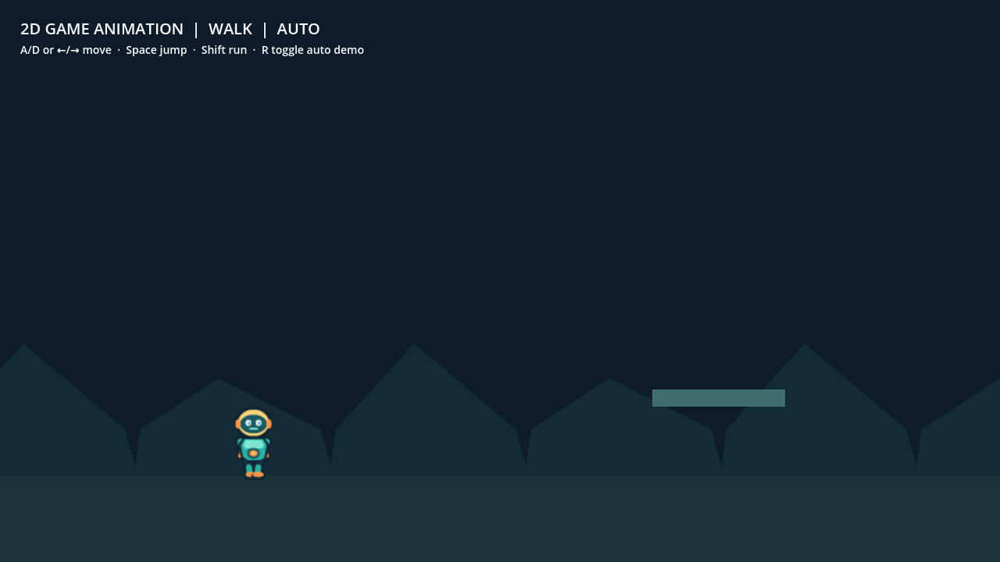
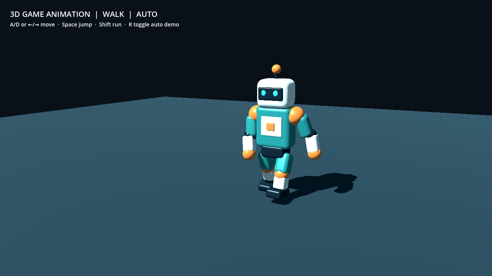

# Fortis Game Animation Lab

Небольшой Godot-проект для проверки полного workflow создания игровых ассетов:
**создали ассет → сделали анимации → экспортировали → подключили в Godot → проверили в работающей сцене**.

Целевой движок: **Godot 4.7.2**.

## Что уже есть

### 2D pipeline
- tools/make_2d_assets.py рисует персонажа и восемь кадров: 2 Idle, 4 Walk, 2 Jump.
- assets/2d/robot_animation_source.ora — редактируемый OpenRaster-файл, кадры разнесены по слоям (открывается в Krita).
- assets/2d/robot_atlas.png — горизонтальный atlas 8 × 64 px.
- assets/2d/robot_atlas.json — координаты кадров и описание анимаций.
- Godot импортирует PNG штатным texture importer, собирает SpriteFrames из atlas и проигрывает их через AnimatedSprite2D.
- Run пока использует ускоренную последовательность Walk-кадров — это проверка state machine, не отдельный production run-cycle.

### 3D pipeline
- tools/make_3d_robot.py создаёт персонажа, armature и четыре Action в Blender.
- assets/3d/source/gamebot_rigged.blend — редактируемый Blender-исходник с ригом и Action.
- assets/3d/gamebot_animated.glb — экспорт для игрового движка: mesh, skin/skeleton и клипы Idle / Walk / Run / Jump.
- Godot импортирует GLB как PackedScene, создаёт AnimationPlayer и управляет клипами через AnimationTree / AnimationNodeStateMachinePlayback.

## Запуск

Открой project.godot в Godot 4.7.2 и запусти главную сцену. В стартовом меню выбери 2D или 3D стенд.

В обеих сценах:
- A / D или стрелки — движение;
- Space — прыжок;
- R — переключение автоматической демонстрации и ручного управления.

Автодемонстрация сама проходит Idle → Walk → Run → Jump.

## Повторная генерация ассетов

Из корня этого проекта:

~~~bash
./tools/build_assets.sh
# если Blender не в PATH:
BLENDER_BIN=/path/to/blender ./tools/build_assets.sh
~~~

Нужны Python 3 и Blender 5.2.x. Для тестов нужен Godot 4.7.2; путь к бинарнику можно передать через GODOT_BIN.

## Автоматические проверки

~~~bash
./tools/run_tests.sh
~~~

Проверка выполняет:
1. импорт PNG и GLB штатным Godot editor importer;
2. целостность PNG, atlas JSON и слоёв OpenRaster;
3. структуру GLB, наличие mesh/skin и четырёх анимационных клипов;
4. запуск 2D-сцены в Godot и проверку, что в каждом из четырёх состояний реально сменились как минимум два sprite frame;
5. запуск 3D-сцены в Godot и проверку, что все четыре узла AnimationTree реально достигнуты, а позиция каждого клипа продвинулась.

Логи сохраняются в tests/results/. Тесты используют --headless, поэтому для CI не нужен монитор.

Для локального запуска скрипты используют tools/godot.sh. Путь к исполняемому файлу Godot можно задать через переменную окружения GODOT_BIN.

## Previews

**2D — Godot AnimatedSprite2D**

**3D — Godot AnimationTree**

## Структура

~~~text
assets/
  2d/   # ORA source, individual frames, atlas, manifest
  3d/   # Blender source, animated GLB, render preview
scenes/ # menu, 2D demo, 3D demo
scripts/ # runtime controllers and state machines
tools/  # asset generators and launch/build scripts
tests/  # asset validation and test logs
previews/ # screenshots captured from the actual Godot scenes
~~~

## Границы MVP

Это технический стенд для проверки передачи ассетов и анимаций между инструментами, а не готовая игровая система. Пока нет root motion, IK, полноценного боевого контроллера, камеры с follow, ретаргетинга и production-grade locomotion blending. Следующий этап — менять тестовые ассеты на созданные художественные ассеты и повторять те же проверки без изменения runtime-контрактов.
